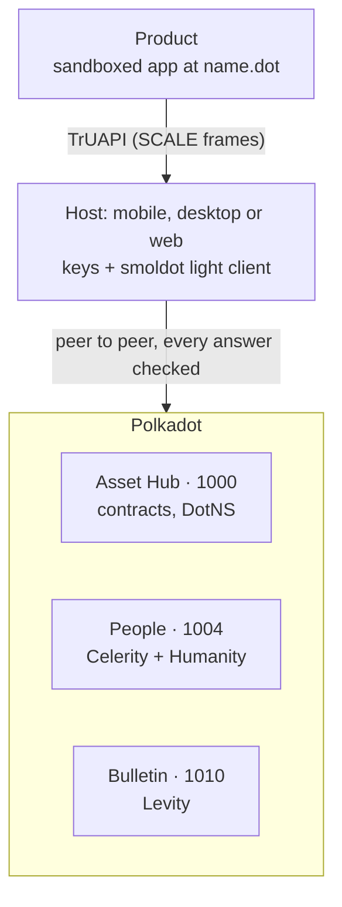

# The Backend You Don’t Run

Slides for the main-stage talk at **Polkadot Assemble Conference: Genesis Mumbai Edition**, Saturday 7 Nov 2026.

> Private messaging, storage and personhood on Polkadot, and you run no servers to do it.

**[▶ Open the slides](https://raw.githack.com/dhirajs0/polkadot-assemble/main/the-backend-you-dont-run.html)**, or download
[`the-backend-you-dont-run.html`](the-backend-you-dont-run.html) and open it in a browser. It is one self-contained HTML file.
A [PDF version](the-backend-you-dont-run.pdf) (15 pages) is also available.

## TL;DR

A typical 2026 hackathon dApp depends on about six operators: a frontend host, an RPC provider, an IPFS pinning service, a
chat backend, a WebRTC signaling server and a bot filter. Polkadot Trinity replaces them with the network itself. A
**light client (smoldot)** runs inside the host and checks every answer, and apps build on three blocks:

| Block | What it gives you | Where it lives |
|---|---|---|
| **Celerity** (Statement Store) | Private messages, presence and call signaling over gossip. Apps encrypt end to end. | People chain, para 1004 |
| **Levity** (Bulletin Chain) | Content-addressed storage (CID + Bitswap), kept about 14 days and renewable | Bulletin chain, para 1010 |
| **Humanity** (proof of personhood) | One unlinkable alias per app, through a ring-VRF proof. No biometrics, no state ID. | People chain, para 1004 |

The twist: **personhood is the rate limiter.** Messaging and storage quotas go to people, not wallets.



## Slides

| # | Slide |
|---|---|
| 1 | The Backend You Don’t Run |
| 2 | Count the servers |
| 3 | What if the backend were the network? |
| 4 | The shape of the stack |
| 5 | The light client is the connection |
| 6 | Celerity: private messages, no server |
| 7 | Calls with no signaling server |
| 8 | Levity: storage that expires, on purpose |
| 9 | Humanity: prove you’re a person, not which person |
| 10 | Personhood is the rate limiter |
| 11 | A bot-free community app (a sketch) |
| 12 | Where it stands today |
| 13 | How it compares, for Ethereum developers |
| 14 | Start today |
| 15 | Count your servers. Then delete them. |

### Controls

| Key | Action |
|---|---|
| `→` `↓` `Space` `PageDown` | Next slide |
| `←` `↑` `Shift+Space` `PageUp` | Previous slide |
| `Home` / `End` | First / last slide |
| `1`–`9` | Jump to that slide |
| `F` | Toggle fullscreen |
| `#N` in the URL | Open at slide N, e.g. `…/the-backend-you-dont-run.html#8` |

## Status, as of November 2026

- **Live on Polkadot:** the chain layer. That means the Bulletin chain (storage since 1 Sep 2026), the statement store
  and personhood pallets on People (10 Sep 2026), DotNS contracts, and lite-person onboarding (Ref #1958, 2 Nov 2026).
- **Testnet only:** the developer kit (Paseo Next v2), the personhood recognition game and publishing apps to `.dot`
  names. TrUAPI is `0.x` and ships weekly, so pin your versions.

## Start today (testnet)

```sh
# 1 · Run your Product with a local signing host
curl -fsSL https://raw.githubusercontent.com/paritytech/trinity-user-agents/main/scripts/truapi-host-installer.sh | bash
truapi-host dev -- yarn dev:paseo

# 2 · Add the SDK
pnpm add @parity/product-sdk

# 3 · Ship a static app to a .dot name
npm install -g bulletin-deploy
bulletin-deploy --env paseo-next-v2 ./out your-name.paseo
# → https://your-name.paseo.li
```

## Links

- Quick start: [docs.polkadot.com/apps/quick-start](https://docs.polkadot.com/apps/quick-start)
- Code: [github.com/paritytech](https://github.com/paritytech)
